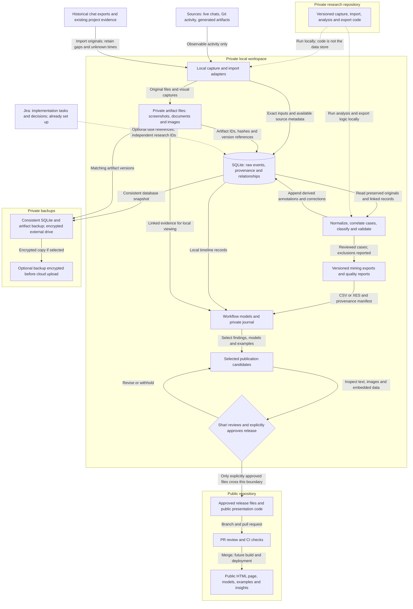

# Project Architecture

Status: draft for Shari's review. November 3, 2026. Jira: SBW-12.
The data contract was approved under SBW-7. This document describes the intended
system and its boundaries; the capture and analysis pipeline is not installed.

## Architecture at a glance

The project separates research tools, private research data, and public results.
Code in the private repository runs locally against private storage. Selected
results enter the public repository only after Shari reviews and approves them.
Jira tracks the work of building this system.

Solid arrows describe planned data or release flows. Dotted arrows describe code
execution or optional tracking relationships. The public repository and Jira
exist; their presence does not mean the other boxes are operational.

## Components and ownership of responsibilities

| Component | Responsibility | Current state |
| --- | --- | --- |
| Source systems | Hold original chats, Git history and design outputs | Existing evidence may be available; access and coverage unverified |
| Private research repository | Version capture adapters, transformations, analysis code and unpublished research documentation | Planned; name and location undecided |
| Local private workspace | Run tools; hold database, artifacts, mining datasets and candidate releases | Planned; choose a location outside Git and synchronized folders |
| Local SQLite database | Authoritative append-only raw event journal, provenance, relationships and versioned annotations | Planned |
| Local artifact folder | Original files and captures linked by stable artifact IDs and versions | Planned |
| Mining pipeline and journal | Produce reproducible datasets, quality reports, models and private chronological browsing | Planned |
| Publication review | Shari selects and approves exactly what may be public | Policy established; enforcement tooling planned |
| Public repository | Store approved public documentation, results and presentation code | Exists: sharibenko/shari-benko-workflow |
| Public HTML presentation | Explain the design process, evidence, limitations and practical improvements | Planned; hosting and deployment undecided |
| Jira | Track implementation tasks, decisions and acceptance | Exists: Shari Benko Workflow, key SBW |
| Private backups | Restore a consistent database and its linked files | Planned; destination, schedule and key handling undecided |

Raw conversations and working datasets stay outside both repositories. A private
repository controls access to its code and documents; it is not the database.
The public repository may contain this architecture and other approved planning
documents. Future internal research planning belongs in the private repository.

## Capture and historical imports

Live adapters will observe supported submitted prompts, responses, tool actions,
Git activity and artifact outputs. Actual hook fields and delivery behavior must
be proven in SBW-5/SBW-6. Capture failures and unavailable evidence remain visible.
Public GitHub actions are captured after push or merge; local Git changes retain
local version references until a corresponding browser view exists.

Historical imports use the same event and evidence structure. Preserve exact text,
original timestamps and ordering where retrievable. Unknown source times stay
unknown; receipt/import time is stored separately. Mark inferred classifications,
case assignments and incomplete project coverage. A new screenshot cannot replace
a missing historical screenshot. SBW-4 determines retrieval feasibility.

Source services may already hold original copies. Local storage does not delete
those copies. Any later external model-assisted classification requires a separate
decision about provider access and the exact data transmitted; the initial
architecture assumes local processing and rule-based classification.

## Storage, transformation and mining

Capture writes originals transactionally to SQLite with serialized writes and
scoped deduplication. Files live separately, with database references to IDs,
hashes and versions. Classification runs after durable capture; corrections append
new annotations without changing original observations.

Normalization, case correlation, classification and quality validation produce
versioned mining exports. Export manifests retain source event IDs, transformation
versions, inclusion rules and explicit exclusions. CSV/XES and derived JSONL are
outputs from the database, not competing authoritative journals.

Private models and the journal link back to source events and evidence. Comparison
with a completed project records differences in context and evidence coverage.
Shared patterns remain hypotheses for further study. The exact mining tool and
discovery method remain open decisions.

## Publication boundary

1. Select candidate findings, models and example images into a private staging area.
2. Inspect text, screenshots, metadata, embedded data, identifiers and confidential
   material. Create redacted derivatives where needed, retaining originals privately.
3. Record Shari's explicit approval against an exact release manifest: file list,
   versions/hashes, review date and approval reference. Changing approved files
   requires review of the changed release. Keep any sensitive review notes private.
4. Copy only that approved file set into a public feature branch. Do not connect
   the public build to SQLite, the private artifact folder or the private repository.
5. Open a PR, pass applicable checks and merge. Future deployment uses the public
   repository's approved files. A merge alone does not imply deployment exists.

Unapproved candidates stay private. Public CI must not read raw research data,
receive private storage credentials, or print raw prompts in logs. Link only
approved derivatives from public HTML; do not embed private paths or URLs.
These controls are requirements to implement, not claims of automated enforcement.

## Backups and recovery

Create a consistent SQLite snapshot together with the referenced artifact versions
and an integrity manifest. Encrypt external-drive backups and test a restore into
a separate private location, checking database integrity and linked-file hashes.
If off-site backup is later selected, encrypt before upload and retain control of
the key. The diagram's optional cloud path is not authorization to upload data.

Choose retention, deletion, backup schedule, recovery objectives and key recovery
before live collection. Repository history cannot restore research files that
were deliberately kept outside Git.

## Jira's role

Jira tracks implementation work for this project. Research records have their own
permanent identifiers and do not depend on Jira. When useful, a record may include
an optional link to a related Jira task. No Jira task is required per prompt or
design activity. Store project tracking summaries in Jira; keep full prompts and
raw evidence in private local storage.

## Delivery and acceptance

| Ticket | Architecture dependency |
| --- | --- |
| SBW-7 | Approved event/case contract defines records across live and historical paths |
| SBW-4 and SBW-5 | Establish historical access and supported live capture |
| SBW-6 | Prove exact capture and report limitations |
| SBW-8 | Set up private storage, durable logging and categorization |
| SBW-9 | Implement version-linked artifact capture and screenshots |
| SBW-10 | Validate reproducible mining transformations and exports |
| SBW-11 | Build the journal and discovery pilot; review resulting insights |

SBW-12 acceptance: the diagram and explanations cover live/historical sources,
both repositories, local database and artifacts, labeled processing flows,
explicit publication approval, independent Jira tracking, backups, and component
status. Review diagram rendering and repository checks before approval. This
draft remains for review; implementing these components is separate work.

## Related decisions

- [Process Mining Data Contract](Process%20Mining%20Data%20Contract.md)
- [Private Data Storage](Private%20Data%20Storage.md)
- [Data Security Policy](Data%20Security%20Policy.md)
- [Git Pipeline](Git%20Pipeline.md)
- [Product Goals and Planning](Product%20Goals%20and%20Planning.md)
- [Work Log](Work%20Log.md)
